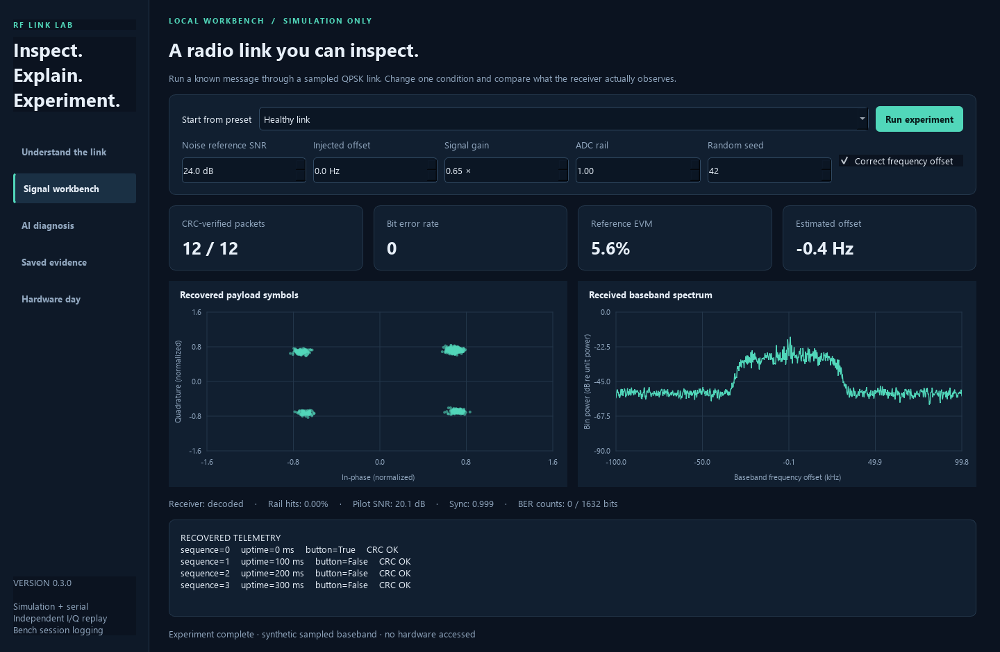
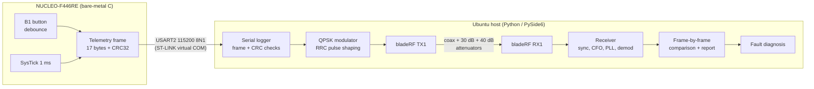
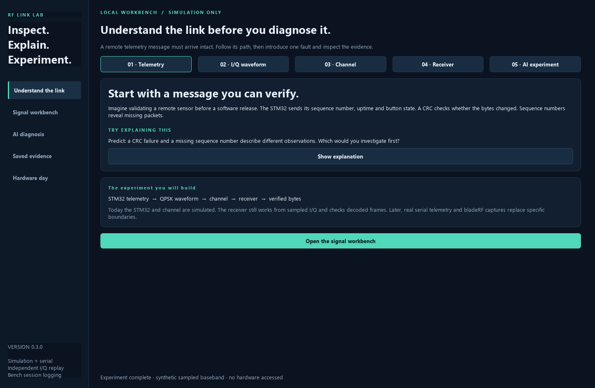
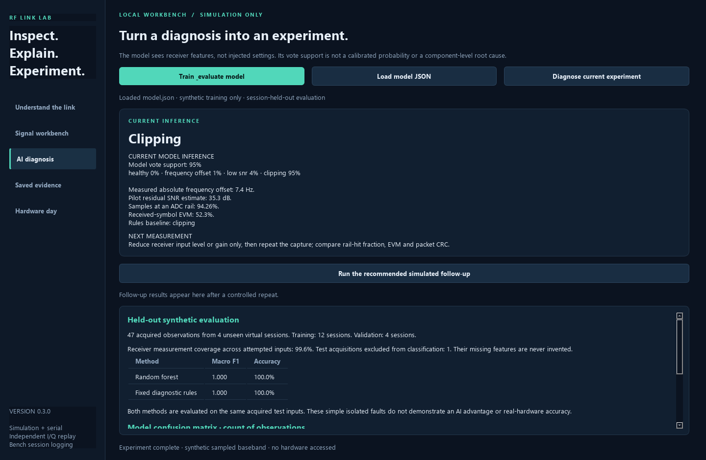
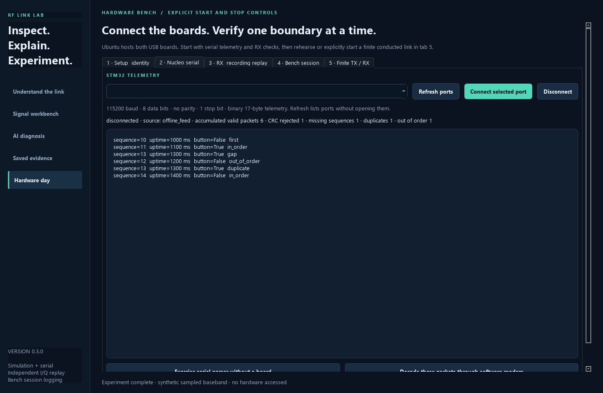
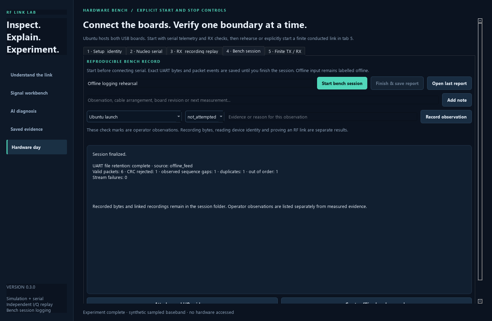
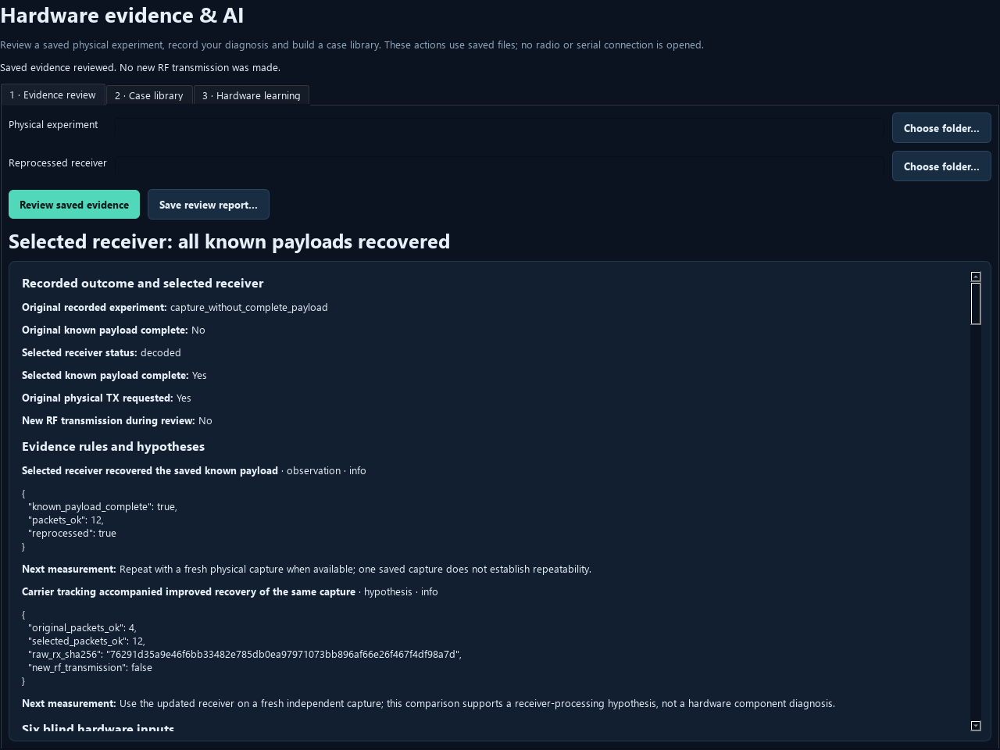

# RF Link Lab

**An end-to-end telemetry radio: bare-metal STM32 firmware → UART → QPSK modem → bladeRF SDR → receiver → automated diagnosis.**

[](https://github.com/RaguJObi/RF-Link-Lab/actions/workflows/ci.yml)


A NUCLEO-F446RE board streams real sensor-style telemetry over UART. A desktop application frames it, modulates it as QPSK, transmits it through a bladeRF 2.0 micro xA9 over an attenuated cable, receives it again, and checks every decoded frame against what was sent. Every run keeps its raw UART bytes, I/Q samples, settings and an HTML report, so failures can be reproduced and diagnosed later.

I built this on my own hardware to practise the full embedded-to-RF path end to end: register-level firmware, a serial protocol, DSP, SDR control, test automation and evidence-based debugging.



## Results on real hardware

| What was tested | Result |
|---|---|
| STM32 firmware on a physical NUCLEO-F446RE | 30-second, 115200-baud recording: **322 valid 17-byte frames**, all CRC-checked; sequence, uptime and both button states verified |
| Real RF link (TX1 → 70 dB attenuation → RX1), original receiver | 4 of 12 frames recovered, 150 bit errors in 1,632 bits |
| Same real capture, after adding a decision-directed QPSK carrier-tracking loop | **12 of 12 frames, 0 bit errors in 1,632 bits** |
| Automated tests | **429 Python tests** plus native C unit tests, run in GitHub Actions on every push |

The 4/12 → 12/12 improvement came from diagnosing the failure from saved I/Q data (residual phase rotation after coarse frequency correction) and adding a type-II PLL to the receiver. The fix was verified by re-processing the original capture; the original result is kept unchanged alongside it. Full details: [VALIDATION.md](VALIDATION.md).

## Architecture



## What's inside

**Firmware — [`firmware/`](firmware/)** (C99, no vendor HAL)
- Hand-written startup code, vector table and linker script for the STM32F446RE (512 KiB Flash, 128 KiB SRAM)
- Register-level clock, GPIO, USART2 and SysTick setup
- 17-byte telemetry protocol (sequence, uptime, button state) with reflected IEEE CRC32, sent every 100 ms and on every debounced button change
- Hardware-independent codec and debounce modules, unit-tested natively on a PC (golden vectors, bounce, hold, timer wrap-around)
- Reproducible cross-compiled build (`.elf`, `.bin`, `.hex`, map) with ELF memory-range and vector checks

**Host application — [`src/rf_link_lab/`](src/rf_link_lab/)** (Python, NumPy/SciPy, PySide6)
- Serial link and logger: byte-exact capture, frame resynchronisation, CRC and missing-frame accounting
- QPSK modem with root-raised-cosine shaping, preamble sync, coarse CFO estimation and a decision-directed carrier-tracking loop
- bladeRF control for finite TX/RX bursts in SC16Q11 format, with gain/frequency plans and safety checks
- Qt desktop workbench showing constellations, spectra, frame tables and per-run HTML reports
- Fault diagnosis: rule-based checks plus a classifier trained on synthetic impairments (clipping, low SNR, frequency offset). It can answer "unknown" and is kept separate from real-hardware results

**Testing and automation**
- 429 pytest tests (protocol, modem, receiver, serial logging, bench sessions, UI), native C unit tests, firmware build verification
- GitHub Actions CI on Ubuntu runs everything headless on every push
- Deployment scripts for packaging and running a bench session on an Ubuntu host

## Screenshots

| Learn the signal chain | Inject a fault | Serial capture |
|---|---|---|
|  |  |  |
| **Bench session report** | **AI diagnosis** | **Hardware evidence review** |
|  |  |  |

## Run it

No hardware is needed for the simulation, tests and saved-capture reports.

```bash
git clone https://github.com/RaguJObi/RF-Link-Lab.git
cd RF-Link-Lab
python -m pip install -e ".[dev]"
python -m pytest -q          # full test suite
python -m rf_link_lab        # launch the desktop workbench
```

Firmware unit tests and build:

```bash
cd firmware
cc -std=c99 -Wall -Wextra -Werror rf_telemetry.c test_codec.c -o test_codec && ./test_codec
cc -std=c99 -Wall -Wextra -Werror rf_button.c test_button.c -o test_button && ./test_button
cd .. && python -m pip install ziglang==0.15.2 && python scripts/build_firmware.py
```

With hardware: a NUCLEO-F446RE and a bladeRF 2.0 micro xA9 on an Ubuntu 22.04 host. See [Connect and run](docs/CONNECT-AND-RUN.md) and [Flash the STM32](docs/FLASH-STM32.md). RF tests use a conducted, attenuated cable path only; nothing is radiated.

## Hardware

| Part | Role |
|---|---|
| NUCLEO-F446RE (Cortex-M4F) | Telemetry source: firmware, UART, button input |
| bladeRF 2.0 micro xA9 (AD9361-based SDR) | Finite TX and RX bursts |
| 30 dB + 40 dB attenuators, 50 Ω loads, SMA coax | Safe conducted RF path |
| Ubuntu 22.04 x86-64 desktop | Host for both USB boards |

## Documentation

- [Architecture](docs/ARCHITECTURE.md) · [Receiver design](docs/RECEIVER.md) · [Serial protocol](docs/SERIAL.md)
- [Validation record](VALIDATION.md): every hardware attempt, including the failed ones
- [Lab notebook](docs/LAB-NOTEBOOK.md): detailed development notes
- [Sources and references](docs/SOURCES.md) · [Third-party notices](THIRD-PARTY-NOTICES.md)

## Limits

- Each run sends one prepared burst. This is not a continuous radio stream, and it does not measure end-to-end latency.
- TX and RX share one bladeRF, so they share a clock reference. A two-radio setup would be a harder test.
- The diagnosis classifier is trained on synthetic impairments only. There isn't enough labelled hardware data yet to train on real captures, and the tool says so instead of guessing.

## Author

**Ragunandhan Dhanasekaran**, embedded software engineer (C/C++, Embedded Linux, RTOS, 5G/RF)
[LinkedIn](https://www.linkedin.com/in/ragunandhan-dhanasekaran1/)

MIT licensed.
