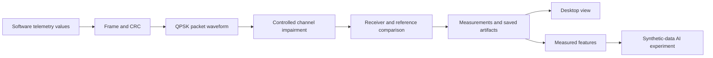

# Architecture and evidence boundaries

RF Link Lab is an original educational/test-automation application. Nuand's host tools remain an external hardware dependency; their driver and FPGA sources have not been copied into this project.

## Current software path



Simulation supplies a known reference so the receiver can report bit errors and constellation error. These are model measurements under the stated assumptions. An arbitrary hardware recording does not contain this reference; its raw waveform can be replayed and plotted without inventing decoded packets, EVM, BER, or a diagnosis.

## Current modem model

The initial waveform uses a repeated pilot, a fixed synchronization sequence, and QPSK payload symbols with root-raised-cosine shaping. The demonstration defaults to 200,000 complex samples/s and four samples per symbol, giving 50,000 symbols/s. The receiver estimates carrier offset, finds integer sample timing, fits one scalar channel, and checks telemetry CRCs. It does not implement fractional timing recovery, independent sample-clock drift tracking, multipath equalization, fading, or forward error correction.

The displayed spectrum is a Welch spectral power estimate in **dB relative to unit complex power**. It uses spectral-power scaling rather than power-density scaling, so its units are not dB/Hz. The reference is independent of the configurable simulated ADC rails: the values are not dBFS or calibrated dBm.

The first RX capture adapter starts at 1 million samples/s. The independent receiver accepts supported integer samples-per-symbol ratios, and recording reprocessing can explicitly resample a compatible 50,000-symbol/s recording to the 200,000-sample/s modem rate. `decode_recording()` reprocesses saved I/Q without regenerating transmission. It preserves sampling and source metadata and reports acquisition failure or unavailable reference metrics explicitly. This integration is software-tested; its behavior on real bladeRF captures still requires bench validation.

## Equipment integration and validation boundaries

**NUCLEO → host:** the compiled STM32 firmware is designed to generate binary telemetry through USART2 and the factory ST-LINK virtual COM route. `protocol.py` defines the wire format and incremental parser. `firmware/` contains complete startup/linker, clock, GPIO, UART, debounce and LED code, with portable codec/button tests. Compilation and image inspection are complete; physical boot, UART routing and button behavior remain unverified. Bounded UART polling is used at this low telemetry rate; DMA/interrupt queueing is a later extension if requirements justify it.

**bladeRF → host:** `hardware.py` wraps explicit identity queries and finite, receive-only captures through `bladeRF-cli`. It has no transmit API. It is tested with mocked processes and byte-format fixtures; live validation is pending. Importing the module and launching the simulator do not probe hardware.

**Raw file → analysis:** `load_sc16q11(path)` reads a single-channel little-endian I/Q recording and normalizes each component by 2048. It validates byte alignment and component range. A raw file does not itself encode sample rate or RF frequency; retain the JSON metadata next to it. Nuand documents this [sample format](https://github.com/Nuand/bladeRF/wiki/bladeRF-CLI-Tips-and-Tricks#binary-data-sc16q11-format).

**Finite conducted link, v0.3:** `conducted_waveform.py` prepares one public-format modem burst, explicitly resamples it, adds bounded zero guards and serializes SC16Q11 without silent saturation. It stores the exact quantized TX stream, payload bits and its measured reference constellation. `conducted.py` either applies a labelled software channel to those saved samples or invokes `bladerf_duplex.py` on Linux. Preparation and rehearsal open no endpoint.

The physical adapter selects one bladeRF serial, verifies requested settings through CLI readback, starts finite RX, requires initial received bytes and remaining capture budget, then explicitly requests TX once with `repeat=1`. Cancellation, timeouts and cleanup are bounded; partial files and errors are retained. A valid connection/power plan is checked at the live boundary. The adapter does not infer a universal attenuator value or convert a gain setting into calibrated output power. Linux uses `stdbuf` from GNU coreutils for the interactive CLI output stream. See [the workflow](CONDUCTED-LINK.md), [waveform contract](CONDUCTED-WAVEFORM.md) and [plan contract](CONDUCTED-PLAN.md).

Saved RX samples go through the independent receiver before comparison with the saved TX reference. CRC-valid received frames and exact expected-frame matches are separate counts. The experiment distinguishes transport completion, complete known-payload decoding, partial decoding, failure and cancellation; its evidence bundle contains TX/RX files, CLI logs, hashes, receiver results and a bench report. Loading or verifying a report reruns no hardware.

The Nucleo contribution is currently a snapshot of selected CRC-valid serial messages, from the current physical session or a verified historical recording. This version is not a continuous serial-to-radio bridge and measures no end-to-end button latency. Using one board for both RF ends shares important hardware references; it does not validate operation between two independent oscillators. The xA9's `rfic_bist` mode is internal digital loopback, so its success would not establish an external RF path. [Nuand loopback reference](https://github.com/Nuand/bladeRF/wiki/Getting-Started:-Verifying-Basic-Device-Operation#loopback).

## Telemetry contract

Each frame is 17 bytes, with all multi-byte integers little endian:

```text
offset  0..1    magic          B5 62
offset  2       version        01
offset  3       payload length 09
offset  4..7    sequence       uint32
offset  8..11   uptime_ms      uint32
offset  12      button         00 or 01
offset  13..16  CRC32          uint32
```

CRC32 covers bytes 0 through 12 inclusive. It matches Python `zlib.crc32`: reflected IEEE CRC32 with polynomial `0xEDB88320`, initial register `0xFFFFFFFF`, and final XOR `0xFFFFFFFF`. It detects accidental corruption; it provides no authentication. Do not assume the STM32 CRC peripheral's default configuration produces the same result.

Golden example for sequence=1, uptime_ms=1000, button=true:

```text
b5 62 01 09 01 00 00 00 e8 03 00 00 01 11 3c d7 26
```

The incremental Python parser accepts partial reads, validates framing/CRC, and searches again after damage. Byte chunks from USB/UART are not guaranteed to align with packet boundaries.

## Hardware adapter contract

`probe_bladerf()` returns `available`, `devices`, `info`, `error`, and `error_kind`. Availability means enumeration and opening succeeded; successful streaming and RF reception remain separate checks. Errors distinguish a missing tool, no device, a timeout, and another device/process failure. No-device output can also mean permissions or exclusive access needs investigation.

`capture_rx(output_path, frequency_hz, sample_rate, samples, gain_db)` accepts explicit integer settings and returns metadata after verifying the expected file length. It selects RX1, disables loopback and RX AGC, records the requested settings alongside CLI readback, and waits for the finite recording to finish. Analog bandwidth is logged rather than selected by this initial adapter. Its project limits are 47 MHz–6 GHz, 1–10 million complex samples/s, 1–20 million samples per recording, and -5 to 50 dB requested RX gain. The installed driver/device remains the authority on achievable settings.

The adapter uses an argument list, no operating-system shell, and a fixed temporary filename. User output paths never enter the CLI command parser. An existing capture is preserved. A timeout or wrong byte count is a failed recording, not synthetic fallback data. The sidecar includes UTC timestamps, requested values, raw readback, commands, length, and SHA256; it records that adapter live validation is pending.

`SerialTelemetrySession` is the persistent receive-only serial boundary used by the UI. An explicit connection starts its bounded-timeout reader; an explicit disconnect stops it. Incremental parsing tracks CRC/framing errors, gaps, duplicates and reordering, with source/session labels and bounded recent history. Live serial input and offline demonstration bytes cannot share an active connection. Port listing does not open a device. The older `read_serial_bytes(port, ...)` helper remains available for a bounded one-shot read. Neither path writes firmware or serial payload; opening a port may affect modem-control lines. See [serial workflow](SERIAL.md) for lifecycle and provenance details.

The v0.2.1 recorder preserves exact UART chunks, timestamps, every decoded packet and lifecycle boundaries independently of bounded display history. Verified offline replay uses the same parser. `BenchSession` combines finalized UART logs, copied I/Q files, submitted identity results and operator observations into a portable report and hash inventory. File completeness, stream failures and physical validation remain separate fields. See [bench-session evidence](BENCH-SESSIONS.md).

## AI responsibilities and limits

The first model is a supervised experiment on simulated examples. It should be compared with simple diagnostic rules and evaluated on new sessions, not duplicated frames from the same example. Do not use injected impairment labels as input features. Synthetic labels are a convenient training source but can teach the model artifacts specific to the simulator.

The current synthetic assistant supplies an explained follow-up and can abstain on unsupported inputs. Its counterfactual changes one known simulator condition and reruns the model; this is a teaching experiment. See the [model card](MODEL-CARD.md) for feature definitions, split policy, baseline comparison, and limits.

Known-payload conducted-link results carry a separate comparison flag and are excluded from this classifier. Successful acquisition and reference availability alone do not establish that its synthetic training distribution covers new hardware or rehearsal results. Collect separate hardware sessions and evaluate the model before enabling inference there.

The ambitious extension is an assistant that earns useful recommendations on real measurements: "These features resemble frequency offset; inspect the corrected constellation and repeat at a known reference." Hardware integration requires separate datasets, calibration checks, mixed faults, unknown signals, session-held-out testing, and an evidence-backed report of where AI helps or fails. A suggested measurement is separate from proven physical root cause.
