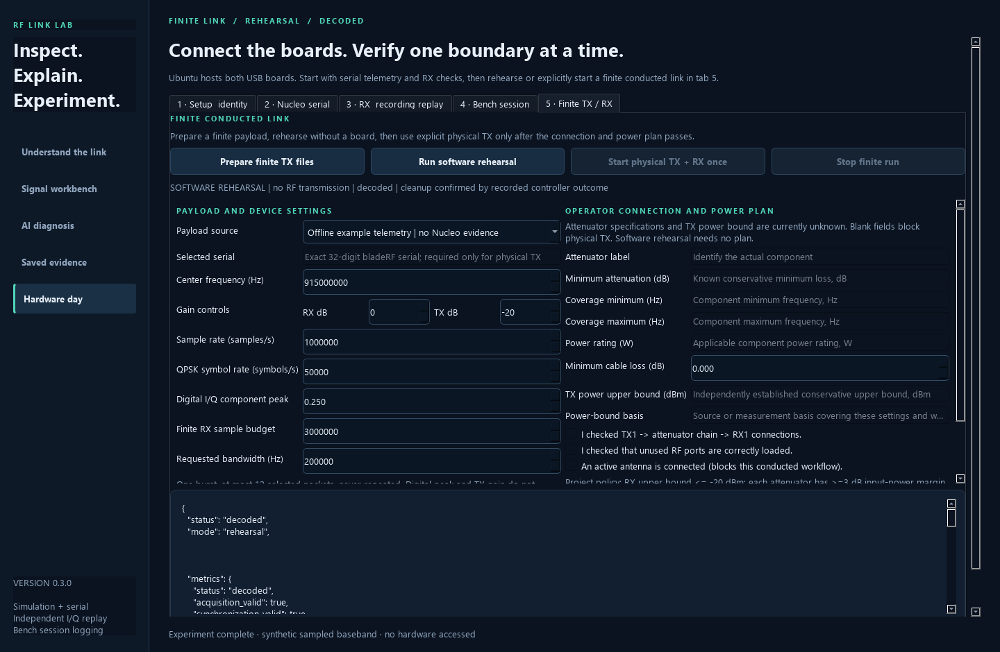

# One finite telemetry burst through a conducted RF path

Version 0.3 prepares the complete software workflow for this experiment:

```text
Nucleo → Ubuntu serial snapshot → QPSK + SC16Q11 file
                                      ↓
                              bladeRF TX1
                                      ↓
                         reviewed attenuators + cable
                                      ↓
                              bladeRF RX1
                                      ↓
                    independent receiver + known-payload report
```

Current access, 21 October 2026: Ubuntu and hardware are unavailable. Earlier
Ubuntu sessions established UART and finite real TX/RX transport. The updated
receiver recovers 12/12 exact messages from one saved physical capture; the
new v0.3.2 package still needs target execution and a fresh run.

Use [Ready for hardware](READY-FOR-HARDWARE.md) for the current matched-stack
daily command and [the plan guide](CONDUCTED-PLAN.md) for the reviewed
BW-S30W20+/BW-S40W20+ chain, loads and explicitly unmeasured planning envelope.
Recheck the refitted chain before reusing that historical plan. The software
rehearsal below is optional and is outside the user's current hardware path.



## Understand the experiment before connecting RF

The Nucleo is a telemetry source. It sends sequence, uptime and button fields
over ST-LINK's virtual COM port; it does not directly control bladeRF pins.
Preparation takes an explicit snapshot of selected CRC-valid messages. The
resulting radio burst is finite and independent of later button changes.
This version does not establish continuous serial-to-radio streaming,
end-to-end button latency, or communication between independent oscillators.

The prepared waveform has a public acquisition preamble, actual telemetry
frames, explicit rate conversion, digital scaling and leading/trailing zero
guards. The exact quantized words and known payload references are saved.
Decoding never regenerates a replacement transmitter from configuration.

## 1. Prepare and rehearse without boards

Open **Hardware day → 5 · Finite TX / RX**.

1. Select the offline example payload. Choose **Prepare finite TX files** and
   a new output folder. Inspect `tx.json` for rates, duration, frame values,
   digital scaling and hashes; preparation opens no endpoint.
2. Choose **Run software rehearsal** and a different new experiment folder.
   The program applies a labelled software channel to the saved quantized TX
   samples and runs the independent receiver. Rehearsal opens no radio or
   serial port and requires no physical connection plan.
3. Inspect matched, missing and unexpected frames, BER scope and reference
   EVM. Choose **Show saved decoded I/Q** to inspect the receiver result or
   **Open last bench report** for the portable evidence.
4. Keep the complete experiment folder. Its declared origin must remain
   `synthetic_duplex_rehearsal`; successful rehearsal does not validate RF.

The same workflow is available in a source environment:

The bundled [reference rehearsal report](../artifacts/reference/conducted-rehearsal/report.html)
shows a software-only 12/12 known-frame result with zero errors in 1,632
compared bits. It is an example of report interpretation, not RF validation.

```bash
python -m rf_link_lab link-prepare --output artifacts/tx-first
python -m rf_link_lab link-rehearse artifacts/tx-first --output artifacts/link-first
python -m rf_link_lab link-verify artifacts/link-first
```

In the Ubuntu portable bundle, replace `python -m rf_link_lab` with
`./START-RF-LINK-LAB.sh`. Every output directory must be new. Windows supports
preparation, rehearsal, offline decode and saved-report inspection. The
physical streaming adapter runs on Linux and needs `bladeRF-cli` plus GNU
coreutils `stdbuf`, both installed by the supplied Ubuntu setup.

## 2. Qualify the two USB paths separately

Follow [Connect and run](CONNECT-AND-RUN.md) first. Establish actual Nucleo
boot, serial/button behavior, bladeRF identity and a finite receive-only
recording. Preserve the failures as well as successful checks in a bench
session; enumeration alone does not establish streaming.

For a payload from the connected Nucleo, select the panel's current physical
Nucleo serial source after receiving verified messages. Preparation snapshots
those messages and records their source/session. The offline parser demo is
not accepted as a physical serial source.

A historical finalized physical-serial recording can be selected from CLI:

```bash
./START-RF-LINK-LAB.sh link-prepare \
  --uart-recording "$HOME/your-recorded-session/uart" \
  --output "$HOME/new-tx-from-uart"
```

That command verifies/replays the saved UART record and snapshots selected
physical-serial rows; it opens no endpoint. Historical receipt is distinct
from a live button-to-radio measurement. Board identity remains a separate
observation rather than something authenticated by a CRC.

## 3. Review the actual connection and power plan

Use [CONDUCTED-PLAN.md](CONDUCTED-PLAN.md) for the exact required information.
The panel's unknown values start blank and physical-check boxes start
unchecked. Populate them only from the selected equipment and a supported
TX output-power bound. Digital amplitude and the TX gain control do not
themselves establish output power in dBm.

The single-stage form covers one identified attenuator. **Load plan JSON**
supports a reviewed multi-stage plan; **Use single-stage form** returns to the
form. Select the exact 32-hex-digit bladeRF serial and matching settings, then
choose **Check current plan**. A passing result means typed operator
declarations and project policy passed; it measures no RF and authenticates
no connection or component. Changing settings, cabling, components or waveform
power assumptions requires a fresh review.

Only after this review use the conducted path **TX1 → reviewed attenuator
chain and cable → RX1**, with the specified port/loading checks. There is no
over-the-air transmit workflow. With the present unknown component data, this
stage remains pending.

The controller's TX setting is **overall channel gain**, defaulting to
**-20 dB**, with a supported project integer range of **-23 through 66 dB**.
It is not the AD9361 TX digital step-attenuator value. Those controls have
different references and ranges; copying a DSA attenuation number into
`set gain tx1` can be invalid. Neither control is an output-power reading in
dBm. The separate physical power bound must cover the actual overall gain
and waveform settings.

## 4. Explicitly start one physical run on Ubuntu

Choose **Start physical TX + RX once** and a new experiment folder. This
action invokes the hardware adapter. Starting the app, preparing files,
checking a plan, loading reports and software rehearsal invoke no TX.

The controller selects the declared device, disables loopback and bias tees,
sets both channels, and checks actual frequency, sample rate, bandwidth and
gain readbacks. It starts finite RX first. Initial received bytes, a running
RX state and remaining capture budget must be observed before the TX request.
It then offers the prepared file once with `repeat=1`; no automatic retry or
infinite transmitter is configured. In this initial controller, TX lasts at
most 0.5 seconds including guards, and the finite RX window lasts 1–5 seconds.

These readiness checks are software sequencing evidence, not a proven
hardware synchronization guarantee. The first physical run must establish
that the desired burst is actually inside the saved receive window. A shared
board clock also makes this a narrower test than two independent radios.

Choose **Stop finite run** to request cancellation. The worker performs
bounded stop/state checks and preserves its logs/outcome. A terminated host
process is not sufficient evidence that RF cleanup succeeded. If cleanup
cannot be confirmed, the result retains that status; check the actual board
state and review the plan before another run. The app waits for the worker
when closing rather than silently abandoning an active operation.

## 5. Read the result in the right order

First inspect transport and cleanup, then acquisition, then exact payload
recovery. They answer different questions:

- A complete finite capture means the expected raw bytes were retained with
  the recorded transport outcome. It does not by itself prove telemetry.
- `packets_ok` counts all CRC-valid received frames. Exact expected-frame
  matching separately counts matched, missing, unexpected and excess duplicate
  frames. An unrelated valid packet cannot replace an expected packet.
- `decoded` means the expected payload was recovered in this experiment.
  `capture_without_complete_payload` retains a completed capture that did not
  recover it all. Failures and cancellations retain their own statuses.
- BER requires aligned known bits. Incomplete payload comparisons retain
  compared/erased bit counts and a separately scoped partial comparison;
  missing frames are not promoted into a full-payload BER of zero.
- Reference EVM is based on the saved quantized TX stream and available
  aligned decisions. It is conditional and uncalibrated. Integer timing after
  resampling can leave EVM even when every compared bit and CRC is correct.

The existing synthetic AI classifier is disabled for these known-payload
results. Collect and evaluate separate hardware sessions before using its
features to infer physical faults.

## Evidence and offline reprocessing

An experiment preserves TX files, raw RX and its sidecar, transport logs,
receiver `run.json`/`capture.npz`, `experiment.json`, and a finalized bench
report. Partial transport output is preserved after failures. Reports retain
the declared origin, requested/read-back settings, TX request and cleanup
states, exact-payload metrics, source notes and hashes. Copy the whole folder.
An active outer bench session can also attach the completed experiment.

`link-verify` checks saved inventory/metadata without opening hardware or
rerunning a receiver. To genuinely reprocess existing raw RX with its saved TX
reference into a new result:

```bash
./START-RF-LINK-LAB.sh link-decode \
  "$HOME/your-experiment/hardware/rx.sc16q11" \
  "$HOME/your-experiment/tx" \
  --output "$HOME/new-redecoded-result"
```

Hash verification detects changes relative to saved declarations; it is not
authentication of a source or a calibration certificate. See the
[waveform/reference API](CONDUCTED-WAVEFORM.md),
[CLI adapter lifecycle](BLADERF-DUPLEX.md),
[independent receiver](RECEIVER.md) and
[bench evidence format](BENCH-SESSIONS.md) for the lower-level contracts.
