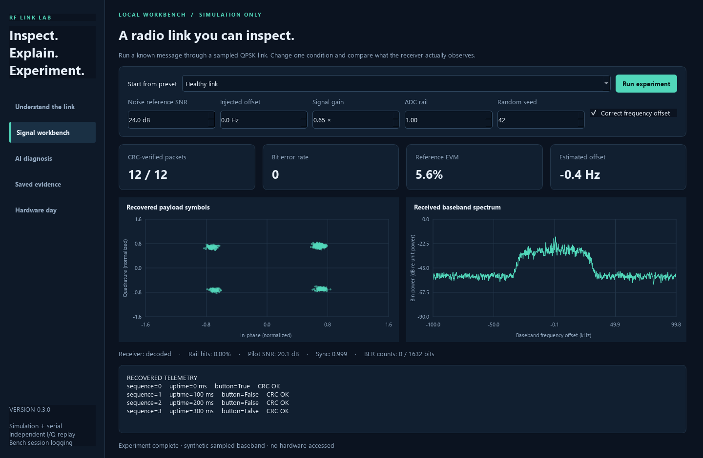
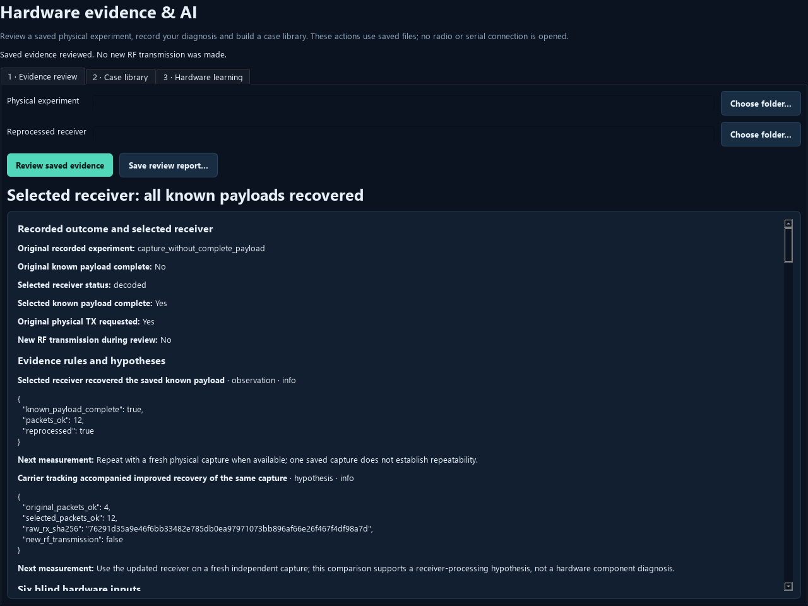

# RF Link Lab — lab notebook

_Detailed engineering notes kept during development. For the overview, see the [main README](../README.md)._


**Understand a telemetry radio, reproduce its failures, then test an AI diagnosis.**

RF Link Lab is an original embedded/RF learning and validation project for a bladeRF xA9, NUCLEO-F446RE, Ubuntu desktop and optional Windows laptop. The Nucleo sends real UART telemetry; Ubuntu prepares a finite QPSK snapshot, transmits through an attenuated TX1-to-RX1 cable path, and compares decoded telemetry with the offered payload. Raw UART, I/Q, device settings, failures and reports are preserved.

**Current evidence:** the physical Nucleo recording contains 322 valid packets and both button states. Matched bladeRF tools/FPGA and finite real TX/RX have run on Ubuntu. Reprocessing a preserved real capture with blind carrier tracking recovers **12/12 exact telemetry frames, zero errors across 1632 compared bits**; the original receiver's 4/12 result remains preserved. This is saved-capture reprocessing, not a fresh transmission. Ubuntu v0.4.0 is prepared and packaged locally; its deployment, target execution and fresh daily run remain pending.

**Current availability — 21 October 2026:** the hardware is disconnected and the Ubuntu desktop is unavailable. Work continues locally; no SSH, board access or new RF transmission is being attempted. Start with [Ready for hardware](READY-FOR-HARDWARE.md) for the prepared update kit and exact steps to run when Ubuntu returns.

Use the [hardware guide](HARDWARE-FIRST-RUN.md) for actual connections, commands and evidence boundaries. The [bench guide](BENCH-SESSIONS.md) describes recording/reporting. Existing simulation and [software rehearsal](../artifacts/reference/conducted-rehearsal/report.html) examples remain optional; they are separate from this physical session.



## Start with the project, then the AI

Start by following one real packet through UART, QPSK, the cable and decoding. Explain its sequence, uptime and button fields, inspect CRC/missing-frame counts, and keep the original capture when changing the receiver. The [first walkthrough](START-HERE.md) retains optional software exercises. The current hardware session skips synthetic loopbacks and rehearsals.

The new [hardware evidence & AI workflow](HARDWARE-AI.md) reviews saved physical experiments, preserves original versus reprocessed outcomes, records supported findings and lets an operator curate a labelled case library. It uses six reference-independent measurements, including exact ADC endpoint counts from the original I/Q file. It separates whole bench sessions for training, validation and test, compares a hardware forest with fixed rules and can return unknown.

**No learned hardware model is available yet.** The saved library contains five cases, three distinct raw captures and one bench session, all labelled unknown. Training is blocked until independent labelled evidence meets the stated requirements. The earlier synthetic classifier remains a separate optional learning exercise; its scores do not establish hardware accuracy.



## First physical hardware session

Use [the hardware-only guide](HARDWARE-FIRST-RUN.md) for the source/runtime transfer, completed Nucleo backup/programming, real UART and cabled RF history. Daily operation records fresh UART and sends one finite snapshot; it does not reflash the board. The Ubuntu v0.4.0 package adds pinned matched Nuand tools, volatile FPGA loading, compatibility checks and the daily helper. The optional Windows archive remains v0.3.0; the source launcher includes the new native evidence tab.

## Ubuntu connection-and-launch package

The current package target is `release/RF-Link-Lab-v0.4.0-Ubuntu22-x86_64.tar.gz` for the **Ubuntu desktop hosting both USB boards**. The archive has been built locally; execution of this new package on Ubuntu remains pending. The package includes Linux Python/dependency binaries, private Nuand CLI 1.10/libbladeRF 2.6 and the xA9 FPGA 0.16 image. Keep the accompanying `Nuand-bladeRF-2025.10-corresponding-source.tar.gz` and notices when distributing it. With the supplied verified cache, no Nuand compilation is needed for normal launch.

The 20 October Ubuntu bench already had its USB permissions, host dependencies and programmed Nucleo. When the desktop is available again, follow the [existing-project update instructions](READY-FOR-HARDWARE.md); keep the old runtime and all recorded sessions. The new application belongs in the project's `runtime-ubuntu` directory. Keep the confirmed wiring: TX1 → 30 dB pad → 40 dB pad → RX1, separate 50 Ω loads on TX2/RX2, and both USB data cables to Ubuntu. No digital jumper wires connect the two boards.

After the new package is installed, run this on Ubuntu:

```bash
PROJECT=/home/rfll/SDR/bladeRF/RF-Link-Lab
APP="$PROJECT/runtime-ubuntu/RF-Link-Lab-v0.4.0-Ubuntu22-x86_64"
PLAN="$PROJECT/artifacts/bench/physical-20261020-121721-P68MXp/connection-plan.json"
SESSION="$PROJECT/artifacts/bench/connected-$(date +%Y%m%d-%H%M%S)-$$"
bash "$APP/RUN-CONNECTED-BENCH.sh" \
  --serial YOUR_BLADERF_SERIAL \
  --port /dev/serial/by-id/usb-STMicroelectronics_STM32_STLink_YOUR_STLINK_ID-if02 \
  --plan "$PLAN" --output "$SESSION"
```

Press/release B1 during the 10-second UART recording. The helper saves fresh bytes, prepares up to 12 verified messages, loads the matching FPGA into RAM and sends exactly one plan-gated burst. Open `$SESSION/rf/report.html` and inspect known-payload completion plus cleanup. Every run uses a new folder. It is a recorded snapshot, not a continuous button-to-radio stream or a latency measurement.

**Execution boundary:** earlier physical results used patched v0.3.1 on Ubuntu 22.04.5 x86_64. The new v0.4.0 package and a fresh run with its receiver still need target validation. See [Validation](../VALIDATION.md) for original attempts, saved-I/Q reprocessing and the remaining limits.

## Run on this Windows laptop

For a portable install, extract `release/RF-Link-Lab-v0.3.0-Windows-x86_64.zip` and launch `RF-Link-Lab.exe` inside its folder. Keep `_internal` beside the executable. Windows supports preparation, software rehearsal and report review; physical finite TX/RX runs on the Ubuntu host.

For this source working copy, double-click **[Start RF Link Lab.cmd](../Start%20RF%20Link%20Lab.cmd)**. The project-local environment is installed. A reference synthetic model is included; training again is optional.

For a fresh Windows checkout, install Python 3.10 or newer, then run:

```powershell
python -m venv .venv
.\.venv\Scripts\python.exe -m pip install -e ".[dev]"
.\.venv\Scripts\python.exe -m rf_link_lab gui
```

## Ubuntu setup

For source development instead of the portable package, the software uses Python 3.10+ and PySide6. Ubuntu CLI and physical operation have been observed with the earlier patched runtime; the new v0.4.0 package is qualified separately. On Ubuntu 22.04 with Python installed:

```bash
sudo apt update
sudo apt install python3-venv libegl1 libgl1 libxkbcommon0 libxcb-cursor0 fonts-dejavu-core
python3 -m venv .venv
.venv/bin/python -m pip install -e '.[dev]'
.venv/bin/python -m rf_link_lab gui
```

If Qt reports another missing system library, inspect that exact error before adding packages. Existing bench setup need not be repeated. Use `START-HARDWARE.sh --serial EXACT_SERIAL` for physical work so the private matching CLI/library and RAM-loaded FPGA are selected; the system's older stack remains separate. The plain application launcher is also available for report review. See [Hardware day](HARDWARE-DAY.md) for first-host setup.

## Reproducible commands

Run from the repository with its Python environment active:

```bash
python -m rf_link_lab demo --output artifacts/demo
python -m rf_link_lab train --output artifacts/model
python -m rf_link_lab demo --fault clipping --model artifacts/model/model.json --output artifacts/runs/clipping
python -m rf_link_lab replay artifacts/runs/clipping
python -m rf_link_lab decode artifacts/runs/clipping --with-reference
python -m rf_link_lab serial-demo
python -m rf_link_lab link-prepare --output artifacts/tx-first
python -m rf_link_lab link-rehearse artifacts/tx-first --output artifacts/link-first
python -m rf_link_lab link-verify artifacts/link-first
python -m rf_link_lab self-test --output artifacts/self-test.json
python -m pytest -q
```

On Windows without environment activation, replace `python` with `.\.venv\Scripts\python.exe`. A saved run contains a capture hash, numeric I/Q arrays, settings, receiver metrics, CRC-valid telemetry and a standalone HTML report. `replay` displays recorded metrics; `decode` genuinely reprocesses the saved I/Q without regenerating transmission. Without `--with-reference`, benchmark BER/reference EVM are unavailable. Models are portable data-only JSON rather than executable pickle files.

## What is implemented

- 17-byte little-endian telemetry with CRC32, stream resynchronization and a compiled STM32 firmware image. Actual F446 programming and 115200-baud UART/button-state reception are recorded; visual LED behavior is unverified.
- Gray QPSK mapping, root-raised-cosine shaping/matched filtering, public-preamble acquisition, measured frequency-offset estimation and correction, and independent CRC decoding.
- Gain, phase, integer delay, additive noise and separate I/Q clipping rails. Noise uses a unit-power reference; changing gain also changes received SNR. Fractional timing error, multipath, sample-clock drift and I/Q imbalance are future work.
- Known-reference BER/EVM, explicit bit denominators and missing-frame counts, estimated SNR, rail-hit fraction and a Welch power spectrum. Spectrum power is relative to unit complex power, **not calibrated dBm or ADC-relative dBFS**.
- Hardware case review with source-hash verification, transport checks, immutable review exports, revisioned operator labels and explicit bench-session grouping.
- Separate hardware-only forest training with session-separated evaluation, fixed rules, abstention and a blocked state when real evidence is insufficient. No hardware AI score is claimed.
- An earlier four-class synthetic learning example remains available as a separate teaching exercise.
- Native Qt walkthrough, constellation/spectrum plots, experiment export, saved-run viewing, independent file reprocessing, explicit RX capture controls and persistent serial counters/recovery.
- Explicit-only bladeRF identification and finite RX capture adapter, plus SC16 Q11 file interpretation.
- Finite conducted TX1/RX1 controller: one selected device, one prepared burst, `repeat=1`, RX readiness and settings readback checks, explicit start/cancel, bounded cleanup and retained failure evidence. Real matched-stack transports and partial original packet results are preserved; blind carrier tracking recovers the full payload when reprocessing one real capture.
- Exact quantized transmit references, independent known-payload comparison, separate missing/unexpected/duplicate frames, offline rehearsal and a unified experiment/bench report. A successful capture alone is not a complete-payload result.

## Evidence and limitations

The v0.2 reference training attempt contains **240 synthetic inputs** across 20 virtual sessions. The stricter independent receiver supplies complete features for 239 inputs; one failed test acquisition is logged separately. Classifier macro F1 is 1.00 for both the forest and rules on 47 acquired held-out inputs. These scores are conditional on successful measurement extraction, not end-to-end accuracy across all inputs. No AI advantage or hardware accuracy is established. Read the [model card](MODEL-CARD.md).

Physical UART and finite RF evidence are recorded separately from the seeded [simulation report](../artifacts/reference/healthy/report.html). The saved real capture reprocessing recovers 12/12 frames with zero compared bit errors and about 35.03% reference EVM. That normalized EVM is not a calibrated RF-quality qualification. A fresh whole-path v0.4.0 run, native GUI, LED appearance, calibration, standards conformance and independent-radio operation remain unverified. The one-board cable setup shares hardware references. The existing AI classifier remains disabled for these conducted-link measurements until separately evaluated.

## Repository map

- [Architecture and wire protocol](ARCHITECTURE.md)
- [Learning experiments and explained answers](LEARNING-PATH.md)
- [Ready-to-transfer update and reconnection steps](READY-FOR-HARDWARE.md)
- [Hardware-day checklist](HARDWARE-DAY.md)
- [AI model card](MODEL-CARD.md)
- [Official technical sources](SOURCES.md)
- [Implementation and learning progress](PROGRESS.md)
- [Validation evidence](../VALIDATION.md)
- [Firmware image and source](firmware/README.md)
- [Independent receiver API](RECEIVER.md)
- [Serial protocol workflow](SERIAL.md)
- [Persistent UART and unified bench reports](BENCH-SESSIONS.md)
- [Finite TX/RX experiment workflow](CONDUCTED-LINK.md)
- [Quantized waveform and known-payload API](CONDUCTED-WAVEFORM.md)
- [Connection and power plan](CONDUCTED-PLAN.md)

## Record your first bench session

Open **Hardware day → 4 · Bench session**, choose a new session folder and select **Start bench session** before connecting serial. Use the serial tab normally; reconnects remain in the same recording with separate parser boundaries. Device identity queries and RX captures made during the session are included automatically. Add notes and operator observations, then choose **Finish & save report**. Finishing disconnects serial and writes `report.html` plus a hashed `bench.json` inventory. Copy the complete folder to share the evidence.

Without hardware, choose **Create offline bench example**. It records six valid packets plus deliberate CRC/sequence errors and links synthetic I/Q. Hardware checks remain unattempted. The bundled [offline example report](../artifacts/reference/bench-offline/report.html) shows the result.

The same workflow is available from the Ubuntu launcher:

```bash
./START-RF-LINK-LAB.sh bench-demo --output "$HOME/rf-bench-example"
./START-RF-LINK-LAB.sh bench-verify "$HOME/rf-bench-example"
./START-RF-LINK-LAB.sh uart-replay "$HOME/rf-bench-example/uart"
```

Use a fresh output folder for each recording. Verification and replay open no device. An explicit `serial-record --port /dev/ttyACM0 --duration 30 --output NEW_FOLDER` command is also available when the selected board is connected.

## Next versions

1. When Ubuntu and the boards are available again, transfer the prepared v0.4.0 update, execute that package on Ubuntu, and record one fresh UART-to-RF session with its blind carrier tracker.
2. Repeat measured hardware sessions and controlled failures, retaining complete/partial outcomes, cleanup and receiver evidence.
3. Collect labelled independent hardware sessions and evaluate AI against a rules baseline before enabling hardware diagnosis.
4. Profile the system before considering FPGA acceleration or a more complex ML architecture.

Original application/STM32 code is MIT licensed. Nuand tools, corresponding-source companion, FPGA IP, Qt and other dependencies retain their respective licenses; see [Third-party notices](THIRD-PARTY-NOTICES.md). The GitHub workflow runs Python checks, the native Qt self-test, portable C codec/button tests and the STM32 firmware build; that hosted workflow remains unexecuted until the repository is pushed.
